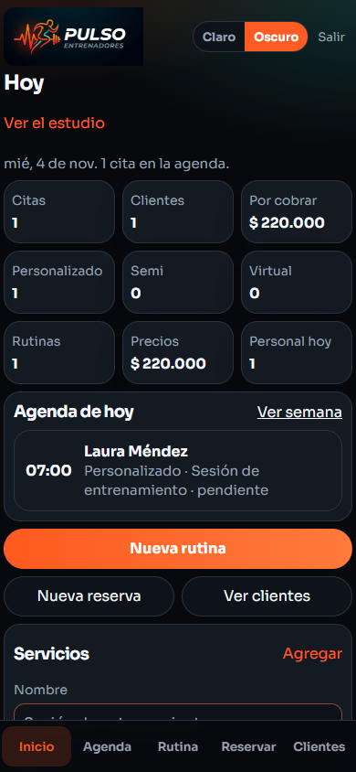
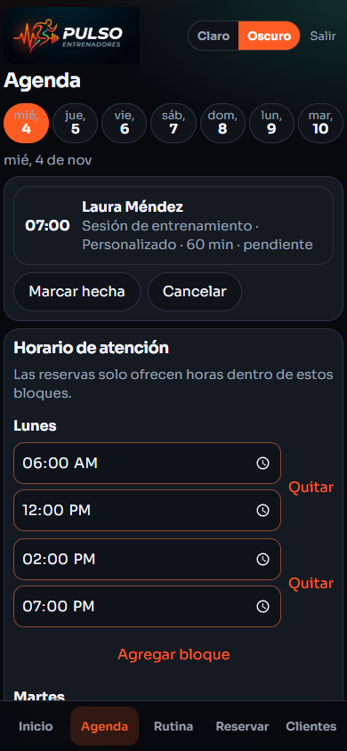
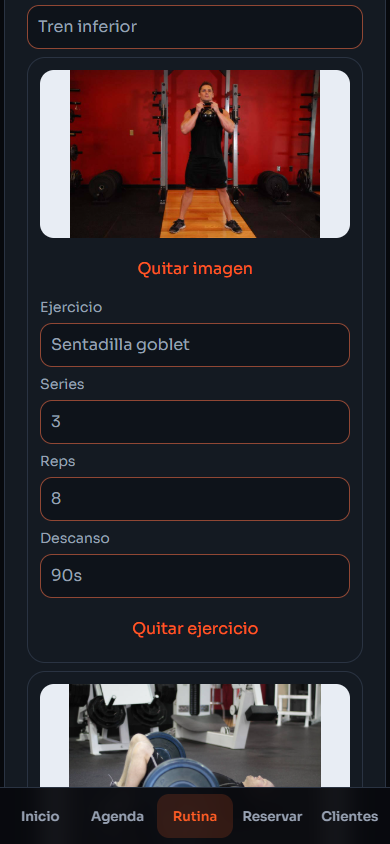
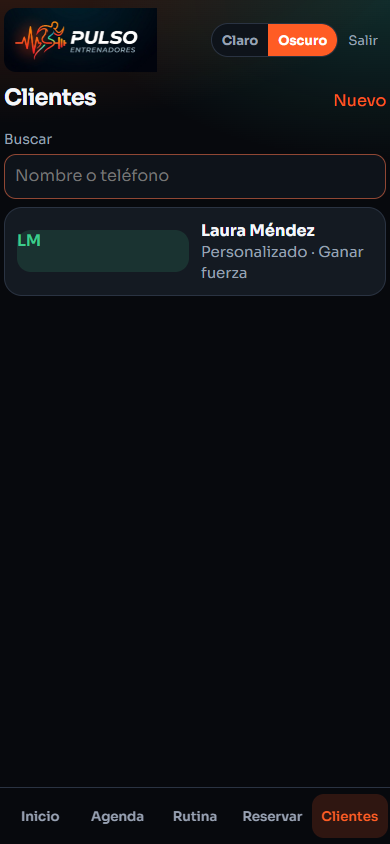
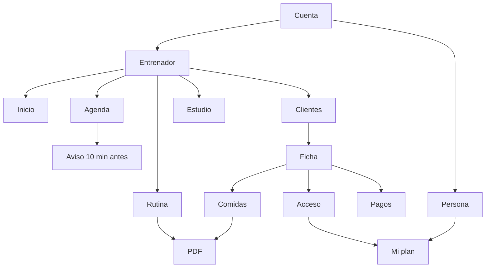

<p align="center">
  
</p>

<p align="center">
  <a href="https://pulso-seven-tau.vercel.app"><strong>Abrir la app</strong></a>
</p>

<h1 align="center">El estudio, en el celular</h1>

<p align="center">
  Pulso es la app del entrenador personal.<br>
  Agenda, clientes, rutina, alimentación y el cobro de cada mes.<br>
  La persona entra y solo consulta lo suyo.
</p>

<p align="center">
  Claro y oscuro. Pensada para el teléfono y también para el computador.
</p>

## Así se ve

<p align="center">
  
  
  
  
</p>

<p align="center">
  Inicio · Agenda · Rutina · Clientes
</p>

## Cómo se mueve



El entrenador arma el día. La persona solo entra a ver su plan. El aviso sale con la app abierta, diez minutos antes de un personalizado.

## Tres entradas

| Quién | Qué hace ahí |
| --- | --- |
| **Entrenador** | Ve el día, arma la agenda, reserva, crea la rutina y lleva a su gente. |
| **Persona** | Entra con el acceso que le dio el entrenador. Ve citas, entreno y alimentación. No edita. |
| **Estudio** | Quien administra la app ve cuántos entrenadores hay, las rutinas de cada uno y el precio. |

El enlace del estudio está en Inicio. La barra de abajo se queda en cinco: Inicio, Agenda, Rutina, Reservar y Clientes.

## Qué incluye

| Módulo | Qué resuelve |
| --- | --- |
| **Inicio** | El día, citas, clientes por tipo de acompañamiento, rutinas, precios y lo que falta por cobrar. |
| **Agenda** | La semana, la cita hecha o cancelada, y el horario de atención. |
| **Reservar** | Servicio, día y hora libre. Si el teléfono ya existe, usa ese cliente. |
| **Rutina** | Días, ejercicios, precio y sus ejercicios con series, repeticiones y descanso. |
| **Clientes** | Alta, búsqueda y ficha. Cada persona es personalizada, semipersonalizada o virtual. |
| **Comidas** | Tabla por momento del día. Es una guía del entrenador. |
| **Pagos** | Mensualidad y valoración del mes, más un cobro suelto si hace falta. |
| **PDF** | La rutina y la alimentación se imprimen desde el navegador y de ahí se guardan. |
| **Aviso** | Diez minutos antes de un personalizado, con la app abierta. |

Borrar un cliente se lleva su rutina, sus comidas, sus citas, sus pagos y su acceso.

## El cobro

Cada cliente puede pagar dos cosas todos los meses, por separado:

- la **mensualidad**
- la **valoración** de ese mes

En la ficha, pestaña Pagos, se escriben los dos valores y se generan los cobros. Si el mes ya está, no se duplica.

## La cuenta

El entrenador crea la suya con nombre, correo y contraseña. Desde ahí elige claro u oscuro.

La persona no se registra sola. El entrenador le crea el acceso en la ficha y ella entra a ver su plan.

La pantalla de recuperar pide un código de 4 números. Esta versión todavía no envía el correo: recuperar la contraseña aún no manda nada.

## Aviso de la cita

Si la cita de hoy es de un **personalizado**, la app avisa desde 10 minutos antes y también cuando ya es la hora. Sale una franja dentro de la app. Si se activan los avisos del celular, también llega la notificación.

No avisa un semipersonalizado ni un virtual, y no repite el mismo aviso. La app tiene que estar abierta.

## Con qué está hecha

| | |
| --- | --- |
| App | Angular 21 |
| Lenguaje | TypeScript |
| Estilos | SCSS |
| Datos | Neon (Postgres) y funciones de Vercel |

## Correr el proyecto

```bash
npm install
cp .env.example .env
npm run dev:api
npm start
```

`npm run dev:api` va en otra terminal. Antes, aplica `db/migraciones/001_cuentas_estudio.sql` en la base de Neon.

Pruebas:

```bash
npm test
npm run e2e
```

Abre `http://localhost:4200`. En el celular, en la misma red, usa la dirección que muestra la consola.

## Dónde quedan los datos

Los datos viven en Neon. Se ven igual en cualquier dispositivo. Sin internet la app avisa y no guarda hasta volver.

La app abre vacía: el entrenador crea los servicios, el horario y las personas.

## Cómo está armado

```text
api/             funciones de Vercel
db/migraciones/  esquema de la base
src/app
├── inicio/       día, resumen y servicios
├── agenda/       semana, citas y horario
├── reserva/      cita nueva
├── rutinas/      rutina y precio
├── clientes/     lista
├── ficha/        datos, rutina, comidas, pagos y acceso
├── mi-plan/      lo que ve la persona
├── estudio/      entrenadores, rutinas y precios
├── acceso/       entrar y crear cuenta
├── recuperar/    código para la contraseña
├── modelos.ts
└── pulso.service.ts
```

La columna cabe en el teléfono. En el computador se queda centrada.
